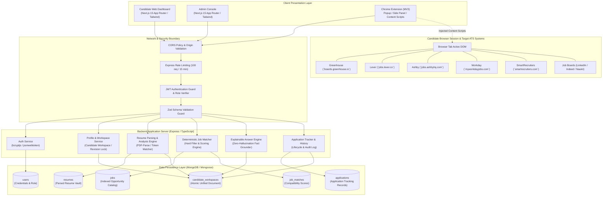
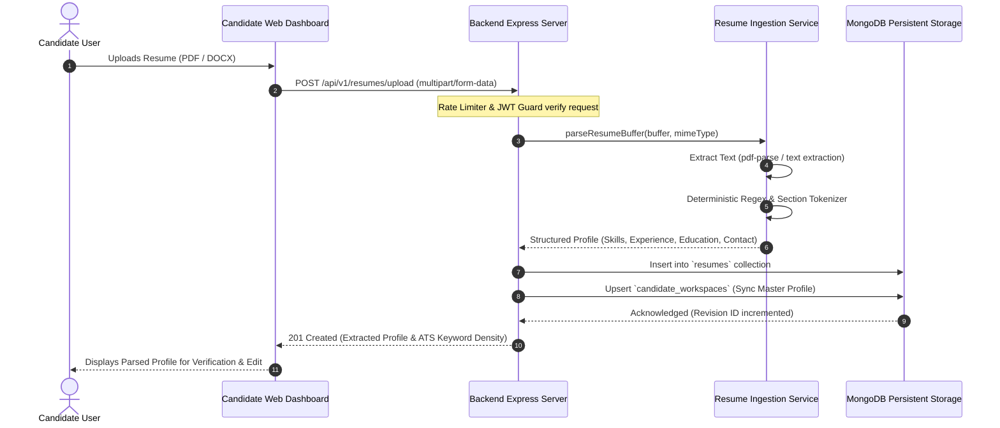
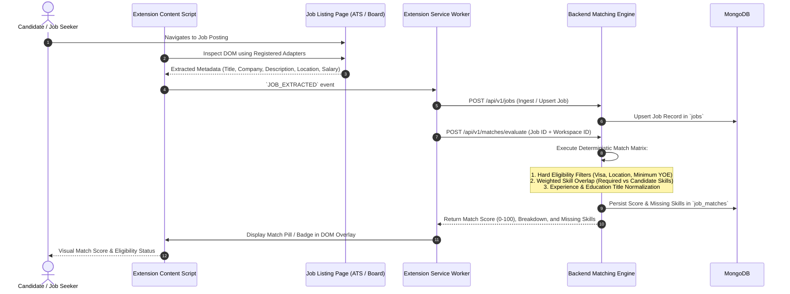
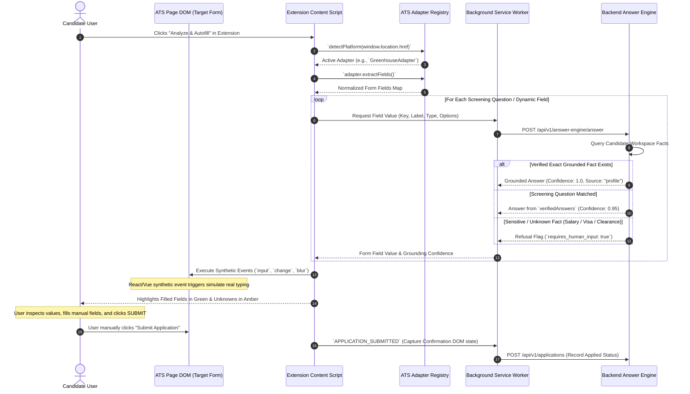

# 02. Comprehensive Architecture Map & Data Flow Topology

> **Document ID:** `AUDIT-02-ARCH-MAP`  
> **Target System:** Auto Apply AI Platform  
> **Auditor:** Forensic Engineering & Architecture Review Team  
> **Audit Status:** Verified against Source Code & AST Analysis  
> **Date:** November 2026

---

## 1. System Context & Architectural Overview

The Auto Apply AI platform is designed as a hybrid career automation ecosystem combining an **Express.js / MongoDB** REST API backend, **two Next.js 15 App Router web clients** (Candidate Web Dashboard and Admin Panel), and a **Manifest V3 Chrome Extension**.

Contrary to marketing claims of an autonomous scraping bot, the architecture enforces a **Human-in-the-Loop (HITL) Controlled Automation** paradigm. The extension inspects applicant tracking system (ATS) web forms in candidate browser sessions, matches them against grounded candidate profile data, populates form fields via custom DOM events, and pauses for manual user verification and submission.

---

## 2. Component Communication & Service Boundaries

### 2.1 Component Interaction Matrix

| Initiating Component | Target Component | Transport Protocol | Authentication / Security | Data Format |
|---|---|---|---|---|
| **Chrome Extension (Popup/Panel)** | Extension Service Worker | `chrome.runtime.sendMessage` | Internal MV3 Message Channel | JSON Messages (`{ type, payload }`) |
| **Extension Service Worker** | Tab Content Scripts | `chrome.tabs.sendMessage` | Tab ID & Active Window Isolation | JSON Commands (`ANALYZE_FORM`, `FILL_FIELDS`) |
| **Extension Service Worker** | Backend REST API | HTTPS / Fetch | Bearer JWT (Stored in `chrome.storage.local`) | JSON Payloads (`/api/v1/*`) |
| **Candidate Web Dashboard** | Backend REST API | HTTPS / Fetch (Client & SSR) | Bearer JWT (`auth_token` Cookie / LocalStorage) | JSON Payloads |
| **Admin Panel** | Backend REST API | HTTPS / Fetch | Bearer JWT (`admin` Role Check in middleware) | JSON Payloads |
| **Content Script** | Active Web Page DOM | Direct DOM API | Isolated Content Script World | Native Element Dispatch Events |
| **Backend REST API** | MongoDB Instance | Mongoose v8 Driver | SCRAM-SHA-256 Auth / Connection Pool | BSON |

---

## 3. End-to-End Data Flow Topologies

### 3.1 Resume Ingestion, Grounding, and Workspace Synchronization

---

### 3.2 Job Extraction, Matching, and Scoring Flow

---

### 3.3 Controlled Form Autofill and User Approval Lifecycle

---

## 4. Architectural Boundaries and Isolation Guarantees

### 4.1 Chrome Manifest V3 Security Boundary
1. **Isolated Content Script Execution:** Extension content scripts operate within Chrome's isolated world execution environment. They do not access the web page's JavaScript global variable scope directly, preventing malicious career sites from reading sensitive JWT tokens or profile state.
2. **Credential Storage:** User authentication tokens are stored exclusively in `chrome.storage.local`. Content scripts never store or cache JWT credentials; all backend-bound operations are routed through the Background Service Worker.
3. **No Dynamic Code Evaluation:** Code is bundled strictly using Vite with `eval` and `new Function` disabled, ensuring full compliance with Chrome Web Store Manifest V3 security requirements.

### 4.2 Data Persistence Architecture
The database layer features an intentional coexistence of two data models:
1. **`candidate_workspaces` (Atomic Root Document):** Implements an optimistic concurrency control mechanism via `revision: Number`. Provides unified access to candidate identity, skills, experiences, and verified profile Q&A in a single sub-document tree.
2. **Normalized Collections (`users`, `resumes`, `jobs`, `job_matches`, `applications`):** Supports relational queries, aggregation pipelines, job catalog searches, and administrative reporting.
3. **Cascade Integrity:** Account deletion (`DELETE /api/v1/candidate-profile`) executes a transactional cascade wipe across all six collections.

---

## 5. Architectural Defects and Technical Debt

1. **Dual State Drift Risk:** `candidate_workspaces` and `candidate_profiles` duplicate personal identity fields. Synchronization is currently maintained via controller logic rather than MongoDB multi-document ACID transactions.
2. **Memory Cache Absence:** Rate limiting uses in-memory counters (`express-rate-limit`), which will not scale across clustered containers or serverless instances without an external Redis store.
3. **Frontend-Backend Decoupling:** The Candidate Dashboard has 14 routes stubbed out with static mock state (`[DEMO DATA]`), leaving the backend APIs functionally ahead of the primary web interface.
4. **Adapter Execution Constraints:** Form filling relies entirely on client-side DOM parsing; changes to third-party ATS DOM hierarchies requires extension client updates unless a remote selector registry is introduced.

