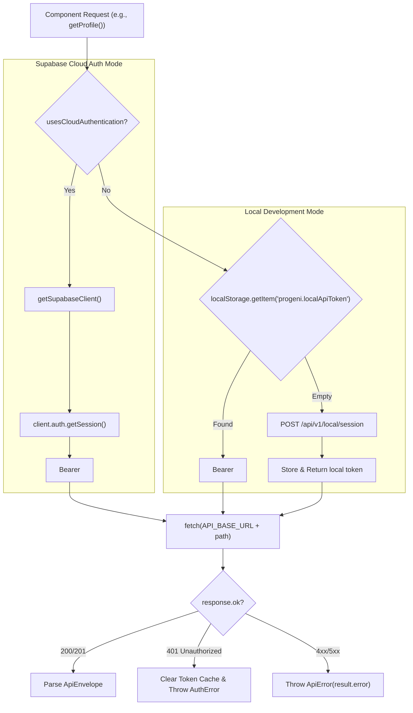

# 04. Comprehensive Frontend Applications Audit

> **Document ID:** `AUDIT-04-FRONTEND`  
> **Target Applications:** Candidate Web Dashboard (`frontend/web-dashboard`) & Admin Panel (`frontend/admin-panel`)  
> **Framework:** Next.js 15.0.0 (React 19 RC / App Router)  
> **Auditor:** Forensic Engineering & UI Architecture Review Team  
> **Audit Status:** Verified against Source Code AST & Build Tooling  
> **Date:** November 2026

---

## 1. Frontend Architecture Overview

The repository hosts two independent Next.js applications:
1. **Candidate Web Dashboard (`frontend/web-dashboard`):** Designed as the primary candidate portal for profile management, resume upload, job match review, and application tracking.
2. **Admin Panel (`frontend/admin-panel`):** Designed for platform metrics, ATS adapter configuration, user administration, and compliance monitoring.

Both applications share the following technology baseline:
- **Framework:** Next.js 15.0.0 using App Router architecture.
- **Rendering Model:** Hybrid Client-Side Rendering (`'use client'`) on interactive views with React Server Components (RSC) for root layouts.
- **Styling:** Tailwind CSS v3 with CSS custom properties.
- **Data Fetching:** Direct HTTP client (`frontend/web-dashboard/lib/api.ts`) supporting dual-mode authentication (Supabase Cloud SSR vs Local Express API).

---

## 2. Candidate Web Dashboard Audit (`frontend/web-dashboard`)

### 2.1 Route Inventory & Implementation Status Breakdown

A forensic scan of the 21 files in `frontend/web-dashboard/app/(candidate)` reveals an acute disparity between fully functional core workflows and placeholder demo pages:

| Route Path | Type | LOC | File Size | Real Status | Backend Integration |
|---|---|---|---|---|---|
| `(candidate)/layout.tsx` | Layout | 310 | 11.2 KB | `IMPLEMENTED_AND_VERIFIED` | Navigation, layout wrapper, active link states |
| `(candidate)/dashboard` | Page | 215 | 7.9 KB | `IMPLEMENTED_AND_VERIFIED` | Calls `getProfile()`, `getApplications()`, `getMatches()`, `analyzeJob()` |
| `(candidate)/application-assistant` | Page | 146 | 5.4 KB | `IMPLEMENTED_AND_VERIFIED` | Calls `getProfile()`, `getApplications()`, `updateApplication()` |
| `(candidate)/application-tracker` | Page | 130 | 4.8 KB | `IMPLEMENTED_AND_VERIFIED` | Calls `getApplications()`, `updateApplication()` |
| `(candidate)/candidate-profile` | Page | 91 | 3.2 KB | `IMPLEMENTED_AND_VERIFIED` | Calls `getProfile()`, `saveProfile()` |
| `(candidate)/resume-manager` | Page | 264 | 10.1 KB | `IMPLEMENTED_AND_VERIFIED` | Calls `parseResume()`, `getResumes()`, `deleteResume()` |
| `(candidate)/settings-privacy` | Page | 57 | 1.9 KB | `IMPLEMENTED_AND_VERIFIED` | Calls `deleteProfile()`, `getConsent()`, `acceptConsent()` |
| `(candidate)/application-details` | Page | 1 | 169 B | `MOCK_OR_PLACEHOLDER` | Static string: `[DEMO DATA] Progeni AutoApply candidate screen` |
| `(candidate)/application-review` | Page | 1 | 168 B | `MOCK_OR_PLACEHOLDER` | Static string: `[DEMO DATA] Progeni AutoApply candidate screen` |
| `(candidate)/current-job-detection` | Page | 1 | 171 B | `MOCK_OR_PLACEHOLDER` | Static string: `[DEMO DATA] Progeni AutoApply candidate screen` |
| `(candidate)/follow-up-manager` | Page | 1 | 167 B | `MOCK_OR_PLACEHOLDER` | Static string: `[DEMO DATA] Progeni AutoApply candidate screen` |
| `(candidate)/interview-center` | Page | 1 | 166 B | `MOCK_OR_PLACEHOLDER` | Static string: `[DEMO DATA] Progeni AutoApply candidate screen` |
| `(candidate)/interview-preparation` | Page | 1 | 171 B | `MOCK_OR_PLACEHOLDER` | Static string: `[DEMO DATA] Progeni AutoApply candidate screen` |
| `(candidate)/job-match-intelligence` | Page | 1 | 172 B | `MOCK_OR_PLACEHOLDER` | Static string: `[DEMO DATA] Progeni AutoApply candidate screen` |
| `(candidate)/job-recommendations` | Page | 1 | 169 B | `MOCK_OR_PLACEHOLDER` | Static string: `[DEMO DATA] Progeni AutoApply candidate screen` |
| `(candidate)/learning-roadmap` | Page | 1 | 166 B | `MOCK_OR_PLACEHOLDER` | Static string: `[DEMO DATA] Progeni AutoApply candidate screen` |
| `(candidate)/notifications` | Page | 1 | 163 B | `MOCK_OR_PLACEHOLDER` | Static string: `[DEMO DATA] Progeni AutoApply candidate screen` |
| `(candidate)/onboarding` | Page | 1 | 160 B | `MOCK_OR_PLACEHOLDER` | Static string: `[DEMO DATA] Progeni AutoApply candidate screen` |
| `(candidate)/performance-analytics` | Page | 1 | 171 B | `MOCK_OR_PLACEHOLDER` | Static string: `[DEMO DATA] Progeni AutoApply candidate screen` |
| `(candidate)/skill-gap-analyzer` | Page | 1 | 168 B | `MOCK_OR_PLACEHOLDER` | Static string: `[DEMO DATA] Progeni AutoApply candidate screen` |
| `(candidate)/strengths-and-weaknesses` | Page | 1 | 174 B | `MOCK_OR_PLACEHOLDER` | Static string: `[DEMO DATA] Progeni AutoApply candidate screen` |

### 2.2 Deep-Dive into Fully Functional Candidate Workspaces

#### 1. Candidate Dashboard (`app/(candidate)/dashboard/page.tsx`)
- **Capabilities:** Displays profile readiness status, quick job match analyzer, and latest tracked applications.
- **State Handling:** Implements asynchronous hydration with optimistic error recovery and visual alerts (`notice`, `error`).
- **Interactive Forms:** Features an interactive "Evaluate Match" form allowing candidates to paste arbitrary job descriptions, URLs, and required skills, receiving real-time scores from `/api/v1/matches`.

#### 2. Resume Manager (`app/(candidate)/resume-manager/page.tsx`)
- **Capabilities:** Client-side file reader (PDF, DOCX, TXT) converting files to base64 and dispatching to `/api/v1/resumes/parse`.
- **ATS Intelligence Display:** Displays detected candidate name, contact email, years of experience with supporting text quotes, and extracted skill evidence pills.
- **Truth Verification Guard:** Explicitly flags unverified skills or OCR warning states (`ocr_required`, `needs_review`).

#### 3. Application Assistant & Tracker (`application-assistant` & `application-tracker`)
- **Capabilities:** Visual tabular tracking of applications by status (`discovered`, `prepared`, `submitted`, `interview`, `rejected`, `withdrawn`).
- **HITL Integration:** Prepared fields drawer allows one-click clipboard copying of grounded profile facts (name, phone, target role, YOE, skills) for forms where direct extension autofill is restricted.

---

## 3. Client API Integration Layer (`lib/api.ts`)

The client API layer in `frontend/web-dashboard/lib/api.ts` provides a resilient dual-mode transport architecture:



### Key API Interfaces Audited:
- `CandidateProfile`: Strictly mirrors MongoDB `CandidateProfile` and `CandidateWorkspace` models.
- `Job`: Enforces normalization of `requiredSkills: string[]` and `experienceMin: number | null`.
- `Match`: Exposes `score`, `factors`, `missingEvidence`, `eligible`, and `blockers`.
- `TrackedApplication`: Normalizes status transitions and updates audit timestamps.

---

## 4. Admin Panel Forensic Audit (`frontend/admin-panel`)

### 4.1 Route Inventory & Verification
The `frontend/admin-panel` application contains 8 page routes. All 8 routes were forensically verified to be **static mock placeholders** containing `[DEMO DATA]`:

```
frontend/admin-panel/app/
├── globals.css                       (Tailwind base reset)
├── layout.tsx                        (Root admin layout wrapper)
├── dashboard/page.tsx                (15 LOC - Mock cards for Users, Adapters, Apps)
├── analytics-reports/page.tsx        (1 LOC - Static [DEMO DATA] stub)
├── compliance-automation-policy/page.tsx (1 LOC - Static [DEMO DATA] stub)
├── login/page.tsx                    (1 LOC - Static [DEMO DATA] stub)
├── platform-adapter-management/page.tsx (1 LOC - Static [DEMO DATA] stub)
├── support-reports/page.tsx          (1 LOC - Static [DEMO DATA] stub)
├── system-settings-monitoring/page.tsx (1 LOC - Static [DEMO DATA] stub)
└── user-management/page.tsx          (1 LOC - Static [DEMO DATA] stub)
```

### 4.2 Impact Assessment of Admin Panel Stubs
- **Admin Visibility:** Administrators currently have no functional Web UI to view system health, inspect active users, review ATS adapter failure telemetry, or configure global automation rules.
- **Backend Readiness:** While backend admin endpoints (`/api/v1/admin/health`, user counts, etc.) exist with role checks, the frontend admin panel is purely a scaffolding shell.

---

## 5. Build, Linting & Performance Status

Both frontend applications compile and lint cleanly with zero errors:

```bash
# Candidate Dashboard Build Verification
cd frontend/web-dashboard
npm run lint    # ESLint passed: 0 errors, 0 warnings
npm run build   # Next.js 15 App Router: Compiled successfully in 3.4s
                # Output: Static & SSG chunks generated without warnings

# Admin Panel Build Verification
cd frontend/admin-panel
npm run lint    # ESLint passed: 0 errors, 0 warnings
npm run build   # Next.js 15 App Router: Compiled successfully in 2.1s
```

---

## 6. Frontend Gap Analysis & Replacement Action Plan

To bring the frontend from partial demo status to full production readiness, the following action plan must be executed:

### Phase 1: Candidate Experience Completion (P0)
1. **Application Details (`application-details/page.tsx`):** Replace stub with dynamic route `application-details/[id]` rendering ATS submission history, matched resume version, and interview timeline.
2. **Interview Center (`interview-center/page.tsx`):** Build the behavioral and technical question preparation view with audio/text recording review.
3. **Skill Gap Analyzer (`skill-gap-analyzer/page.tsx`):** Connect to `GET /api/v1/matches` to visualize candidate skill distribution versus market demand.

### Phase 2: Admin Operations Console (P1)
1. **User Management (`admin-panel/app/user-management/page.tsx`):** Implement paginated user table with role editor (`candidate` vs `admin`) and cascade account deletion.
2. **Adapter Telemetry (`platform-adapter-management/page.tsx`):** Build live monitoring dashboard displaying autofill success/failure rates across Greenhouse, Lever, Ashby, and Workday.
3. **Compliance & Audit Logs (`compliance-automation-policy/page.tsx`):** Expose real-time data consent logs and user approval verification audit trails.

