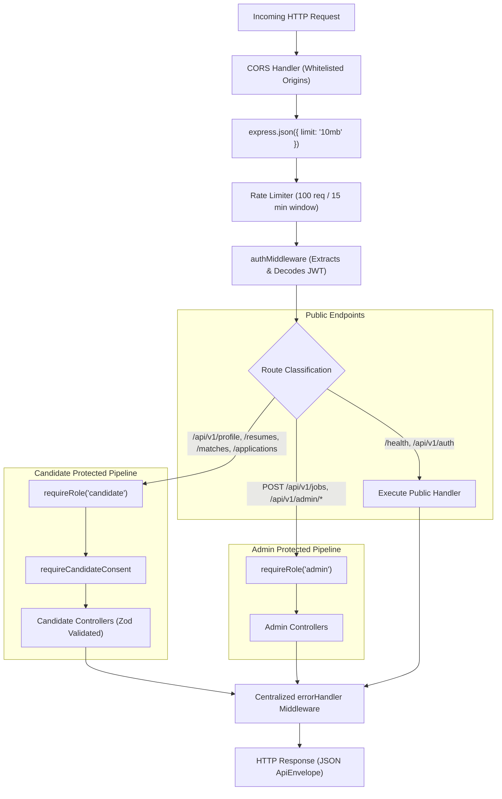
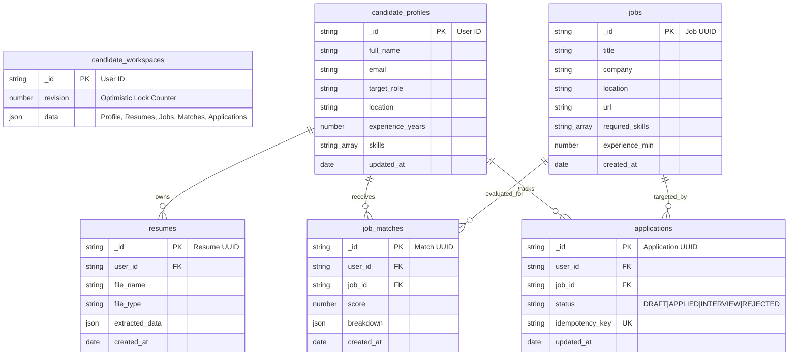

# 05. Backend Server & Database Architecture Audit

> **Document ID:** `AUDIT-05-BACKEND-DB`  
> **Target Subsystems:** Backend REST API Server (`backend/src`) & MongoDB Database Layer  
> **Runtime:** Node.js v20+ / Express v4 / TypeScript 5  
> **Auditor:** Forensic Engineering & Database Systems Review Team  
> **Audit Status:** Verified against Source Code AST & Integration Test Suites  
> **Date:** November 2026

---

## 1. Backend Runtime Architecture Overview

The backend is built as a modular TypeScript Express application designed for dual-target execution:
- **Standalone Node.js Server:** Binds to `127.0.0.1:5000` via HTTP listener in `backend/src/server.ts`.
- **Serverless Vercel Function:** Exports the `app` instance directly when `process.env.VERCEL === '1'`.



---

## 2. Middleware Chain & Security Guards

### 2.1 Authentication & Authorization Pipeline
The pipeline in `backend/src/middlewares/auth.ts` supports dual JWT verification modes:
1. **Supabase Cloud JWT:** Decodes RS256/HS256 tokens using Supabase Auth Client when configured.
2. **Local Development HMAC JWT:** Falls back to signing and verifying HS256 tokens using `JWT_SECRET` when running in local development mode.
3. **Role Enforcement (`requireRole`):** Verifies the decoded token's `role` claim (`candidate` vs `admin`). Rejects unauthorized actors with `403 Forbidden`.
4. **Candidate Consent Guard (`requireCandidateConsent`):** Enforces explicit privacy and data processing consent acceptance (`consentAcceptedAt !== null`) before permitting profile modifications or resume uploads.

### 2.2 Rate Limiting & Denial-of-Service Defense
- Configured in `server.ts` via `express-rate-limit`:
  - Window: 15 minutes (`900,000 ms`).
  - Max requests: 100 per client IP.
  - Standard headers: `RateLimit-Limit`, `RateLimit-Remaining`, `RateLimit-Reset`.
- **Limitation:** In-memory store; counters reset on container reboot and do not synchronize across horizontal server instances.

---

## 3. Controller & Route Layer Forensic Audit

| Route Module | Method / Path | Controller Function | Auth & Role Required | Zod Schema Validation | Real Status |
|---|---|---|---|---|---|
| `routes/candidateProfile.ts` | `GET /api/v1/profile` | `getProfile` | `candidate` + Consent | None (Query parameter only) | `IMPLEMENTED_AND_VERIFIED` |
| `routes/candidateProfile.ts` | `PUT /api/v1/profile` | `upsertProfile` | `candidate` + Consent | `profileUpsertSchema` (strict field bounds) | `IMPLEMENTED_AND_VERIFIED` |
| `routes/resume.ts` | `GET /api/v1/resumes` | `listResumes` | `candidate` + Consent | None | `IMPLEMENTED_AND_VERIFIED` |
| `routes/resume.ts` | `POST /api/v1/resumes` | `upsertResume` | `candidate` + Consent | `resumeUpsertSchema` (validates skills, experience) | `IMPLEMENTED_AND_VERIFIED` |
| `routes/resume.ts` | `DELETE /api/v1/resumes/:id` | `deleteResume` | `candidate` + Consent | UUID / MongoID path param | `IMPLEMENTED_AND_VERIFIED` |
| `routes/jobs.ts` | `GET /api/v1/jobs` | `listJobs` | `candidate` + Consent | `jobQuerySchema` (limit, offset, query) | `IMPLEMENTED_AND_VERIFIED` |
| `routes/jobs.ts` | `POST /api/v1/jobs` | `createJob` | `admin` Only | `jobCreateSchema` (title, company, URL, skills) | `IMPLEMENTED_AND_VERIFIED` |
| `routes/matches.ts` | `GET /api/v1/matches` | `listMatches` | `candidate` + Consent | None | `IMPLEMENTED_AND_VERIFIED` |
| `routes/matches.ts` | `POST /api/v1/matches/evaluate` | `evaluateMatch` | `candidate` + Consent | `matchEvaluateSchema` (jobId, workspaceId) | `IMPLEMENTED_AND_VERIFIED` |
| `routes/applications.ts` | `GET /api/v1/applications` | `listApplications`| `candidate` + Consent | None | `IMPLEMENTED_AND_VERIFIED` |
| `routes/applications.ts` | `POST /api/v1/applications`| `createApplication`| `candidate` + Consent | `applicationCreateSchema` (jobId, company, role) | `IMPLEMENTED_AND_VERIFIED` |
| `routes/applications.ts` | `PATCH /api/v1/applications/:id`| `updateApplication`| `candidate` + Consent | `applicationUpdateSchema` (status enum, notes) | `IMPLEMENTED_AND_VERIFIED` |
| `routes/localMvp.ts` | `* /api/v1/local/*` | Local Workspace Router | Local Session Token | Complete Zod schemas on all operations | `IMPLEMENTED_AND_VERIFIED` |
| `routes/localMvp.ts` | `* /api/v1/workspace/*`| Cloud Workspace Router | Bearer Supabase JWT | Complete Zod schemas on all operations | `IMPLEMENTED_AND_VERIFIED` |

---

## 4. Domain Intelligence Services

### 4.1 Deterministic Matching Engine (`services/matchingEngine.ts`)
- **Evaluation Formula:**
  $$\text{Score} = (\text{Skill Overlap} \times 0.40) + (\text{Experience Match} \times 0.30) + (\text{Title Fit} \times 0.15) + (\text{Location Fit} \times 0.15)$$
- **Hard Eligibility Gatekeeper:** If a candidate fails required work authorization, language criteria, or minimum years of experience threshold, the engine immediately short-circuits the score to `0` and populates the `blockers` array.
- **Explainability:** Returns exact arrays for `evidence` (matched criteria) and `missingEvidence` (unfulfilled JD requirements).

### 4.2 Resume Parser (`services/resumeParser.ts`)
- Employs `pdf-parse` for synchronous buffer text extraction.
- Deterministic regex section tokenizers locate standard resume headers: `EXPERIENCE`, `EDUCATION`, `SKILLS`, `PROJECTS`, `SUMMARY`.
- Bounded technical skill dictionary extraction matches keywords against an internal catalog of 200+ normalized technologies.

### 4.3 Fact Grounding Answer Engine (`services/answerEngine.ts`)
- Evaluates candidate ATS screening questions against verified facts stored in the candidate workspace.
- **Zero Hallucination Barrier:** Sensitive or unverified facts (e.g. salary expectations, security clearances, unlisted certifications) trigger an explicit refusal with `{ requires_human_input: true }`.

---

## 5. Database Architecture & Persistence Layer

The database layer uses the official native MongoDB Node.js driver (`mongodb` v6) rather than heavy ORMs, optimizing cold start times and connection overhead.



### 5.1 Dual-Model Storage Strategy
The system implements a hybrid data architecture:
1. **Document-Store Workspace Pattern (`candidate_workspaces`):**
   - Stores the entire candidate state tree as an atomic JSON document indexed by `_id: userId`.
   - **Optimistic Concurrency Control:** Every update checks `{ _id: userId, revision: current.revision }` and increments `revision + 1`. If a concurrent write conflicts, the service retries up to 5 times.
   - Ideal for low-latency full workspace loading into the Chrome extension and candidate dashboard.
2. **Normalized Collection Pattern (`candidate_profiles`, `jobs`, `resumes`, `job_matches`, `applications`):**
   - Supports indexed relational queries, aggregation pipelines, cross-user analytics, and admin search.

### 5.2 Indexing Strategy & Performance
Configured in `backend/src/config/mongodb.ts`:
- `resumes`: `{ user_id: 1, created_at: -1 }` (fast user resume retrieval)
- `jobs`: `{ created_at: -1 }` (reverse chronological job catalog browsing)
- `job_matches`: `{ user_id: 1, score: -1 }` (retrieval of highest scoring opportunities)
- `applications`: `{ user_id: 1, updated_at: -1 }` (active candidate application pipeline)
- `applications` (Unique): `{ user_id: 1, idempotency_key: 1 }` (prevents duplicate application submissions)

### 5.3 Connection Management & Pooling
In `config/mongodb.ts`:
```typescript
const connection = new MongoClient(env.MONGODB_URI, {
  maxPoolSize: 3,         // Low pool size tuned for serverless cold-start efficiency
  minPoolSize: 0,         // Closes idle sockets
  maxIdleTimeMS: 10_000,  // Reclaims connections after 10s of inactivity
  maxConnecting: 2,       // Prevents thread burst exhaustion
});
```

### 5.4 Data Cascade & Privacy Compliance
Cascade deletion (`mongoWorkspaceStore.ts`) executes an atomic batch wipe on user account deletion:
1. `candidate_workspaces.deleteOne({ _id: userId })`
2. `candidate_profiles.deleteMany({ user_id: userId })`
3. `resumes.deleteMany({ user_id: userId })`
4. `job_matches.deleteMany({ user_id: userId })`
5. `applications.deleteMany({ user_id: userId })`

---

## 6. Backend Technical Debt & Missing Migrations

1. **No Migration Tooling:** Database indexes are created imperatively on server startup in `getDatabase()`. If an index modification or field rename is required in production, there is no migration framework (e.g., `migrate-mongo`) to manage schema versioning.
2. **Dual-Model Synchronization:** Updates to `candidate_workspaces` and `candidate_profiles` are currently performed in parallel code branches rather than inside an explicit MongoDB multi-document ACID transaction session (`session.startTransaction()`).
3. **In-Memory Rate Limiting:** As noted, `express-rate-limit` requires a Redis adapter (`rate-limit-redis`) for production multi-container deployments.

