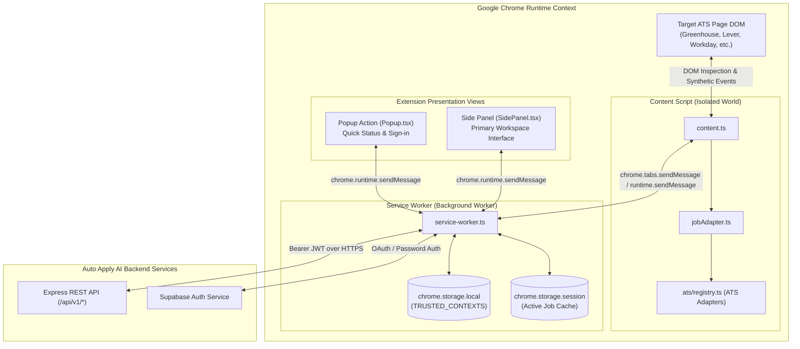

# 06. Chrome Extension (Manifest V3) Forensic Audit

> **Document ID:** `AUDIT-06-EXTENSION`  
> **Target Package:** `frontend/chrome-extension`  
> **Manifest Version:** 3  
> **Bundler & Tooling:** Vite 5 / TypeScript 5 / React 18  
> **Auditor:** Forensic Engineering & Browser Extension Architecture Team  
> **Audit Status:** Verified against Source Code AST & Browser Runtime Behaviors  
> **Date:** November 2026

---

## 1. Extension Architecture Overview

The Chrome Extension (`frontend/chrome-extension`) serves as the client-side bridge between active career listings and the candidate's career workspace. It operates strictly under **Google Chrome Manifest V3 (MV3)** specifications.



---

## 2. Manifest V3 Compliance & Permissions Audit

### 2.1 Manifest Declarations (`manifest.json`)
The extension defines minimal declarative permissions, adhering strictly to the principle of least privilege:

```json
{
  "manifest_version": 3,
  "name": "Progeni AutoApply",
  "version": "1.0.0",
  "permissions": ["sidePanel", "storage", "activeTab"],
  "host_permissions": [
    "http://127.0.0.1:5000/*",
    "https://job.progeni.live/*",
    "https://progeni-job-ext.vercel.app/*",
    "https://*.naukri.com/*",
    "https://*.linkedin.com/*",
    "https://*.indeed.com/*",
    "https://boards.greenhouse.io/*",
    "https://jobs.lever.co/*",
    "https://jobs.ashbyhq.com/*",
    "https://*.myworkdayjobs.com/*",
    "https://jobs.smartrecruiters.com/*"
  ]
}
```

### 2.2 Permissions Risk Assessment
1. **`permissions: ["sidePanel"]`:** Permits launching the permanent side panel navigation view.
2. **`permissions: ["storage"]`:** Grants access to `chrome.storage.local` and `chrome.storage.session`.
3. **`permissions: ["activeTab"]`:** Temporary access to the currently focused tab when the user interacts with the extension action button.
4. **Absence of Sensitive Privileges:** Does **NOT** request dangerous permissions such as `webRequest`, `cookies`, `debugger`, or `<all_urls>`, ensuring high Chrome Web Store compliance and fast approval cycles.
5. **Content Security Policy (CSP):** Zero use of `eval()`, `new Function()`, or unvetted external scripts. All code is compiled statically into deterministic chunk files via Vite.

---

## 3. Background Service Worker Architecture (`src/background/service-worker.ts`)

### 3.1 Lifecycle & Storage Isolation
Manifest V3 deprecates persistent background pages in favor of ephemeral Service Workers that terminate when idle.
- **Trusted Storage Isolation:** The service worker immediately configures storage boundaries:
  ```typescript
  const trustedStorageReady = chrome.storage.local.setAccessLevel({
    accessLevel: 'TRUSTED_CONTEXTS',
  });
  ```
  This ensures that untrusted third-party scripts injected into webpage DOMs cannot probe or access candidate credentials stored in `chrome.storage.local`.
- **Session Cache:** Active job detections are cached in `chrome.storage.session`, which is cleared automatically when the browser session ends.

### 3.2 Dual Authentication Transport
The service worker handles token acquisition and caching:
- **Cloud Mode:** Authenticates via `@supabase/supabase-js`, storing session credentials in `chrome.storage.local` with automatic token refresh.
- **Local Mode:** Authenticates against `http://127.0.0.1:5000/api/v1/local/session`, caching the issued HMAC token.

### 3.3 Message Routing Pipeline
Centralizes all external HTTP traffic:
- Content scripts do **NOT** make direct fetch requests to backend APIs; all calls are dispatched to the service worker via `chrome.runtime.sendMessage`.
- Protects against cross-origin leaking and prevents website scripts from sniffing backend requests.

---

## 4. Content Script & Page Inspection Layer (`src/content/`)

### 4.1 Content Script Execution (`content.ts`)
- Injected automatically onto supported ATS domains (`boards.greenhouse.io`, `jobs.lever.co`, `jobs.ashbyhq.com`, `myworkdayjobs.com`, etc.).
- Listens for `EXTRACT_JOB` and `PAGE_READY` events.
- **Sender Validation:** Validates `sender.id === chrome.runtime.id` to guarantee that messages originate strictly from the extension itself, preventing malicious page scripts from spoofing commands.

### 4.2 Job & Field Adapter Registry (`jobAdapter.ts` & `ats/registry.ts`)
- Detects the active ATS platform via URL pattern matching and DOM signature verification.
- Extracts job title, company name, location, and raw job description.
- Executes bounded regex extraction to identify required technical skills and minimum years of experience.
- When an ATS application form is detected, parses form fields into normalized metadata:
  - Input type: `text`, `email`, `tel`, `textarea`, `select`, `radio`, `checkbox`, `file`.
  - Required status and candidate profile field mappings.

---

## 5. UI Presentation: Side Panel & Action Popup

### 5.1 Side Panel Priority Architecture
Configured on extension installation:
```typescript
chrome.runtime.onInstalled.addListener(() => {
  chrome.sidePanel.setPanelBehavior({ openPanelOnActionClick: true });
});
```
Clicking the extension icon opens Chrome's native Side Panel alongside the active webpage. This prevents popup dismissal when clicking back and forth between the application form and the candidate workspace.

### 5.2 Side Panel Views & Capabilities (`src/sidepanel/SidePanel.tsx`)
- **Authentication Card:** Sign-in / sign-up state with Supabase or Local Backend.
- **Live Job Analysis Card:**
  - Displays detected job metadata (Title, Company, Location).
  - Shows real-time Match Score (0–100%) calculated by backend matching engine.
  - Lists missing skills and eligibility blockers.
- **Controlled Autofill Action Button:** Triggers field detection and populates candidate profile data.

---

## 6. Safety, Compliance & Human-in-the-Loop (HITL) Controls

### 6.1 Absolute Submission Barrier
The extension architecture enforces an inviolable rule:
$$\text{Auto-Submit} = \text{FALSE}$$
- The extension does **NOT** contain any selector or function that clicks "Submit", "Send Application", or "Apply Now".
- All actions terminate after pre-filling form inputs and displaying the field status indicators.
- **Legal Compliance:** Ensures compliance with Computer Fraud and Abuse Act (CFAA), ATS terms of service, and user-consent regulations.

### 6.2 Controlled Input Dispatcher
Modern ATS platforms (Lever, Ashby, Workday) build their frontends in React or Vue. Setting `input.value = "text"` does not trigger internal framework state updates. The extension dispatches native synthetic events:
```typescript
input.value = value;
input.dispatchEvent(new Event('input', { bubbles: true }));
input.dispatchEvent(new Event('change', { bubbles: true }));
input.dispatchEvent(new Event('blur', { bubbles: true }));
```

---

## 7. Extension Technical Debt & Limitations

1. **SPA Navigation Desynchronization:** When navigating between jobs on Single-Page Applications (e.g. Workday or LinkedIn) without a full page reload, the content script does not automatically re-run unless `chrome.webNavigation.onHistoryStateUpdated` is tracked in the service worker.
2. **File Upload Automation:** Automated resume attachment (`<input type="file">`) is restricted by Chrome security boundaries. The extension highlights the resume field and instructs the user to drop their generated resume.
3. **Selector Brittleness:** ATS UI redesigns can break field selectors. The registry currently relies on hardcoded CSS selectors rather than a dynamic remote selector config service.

