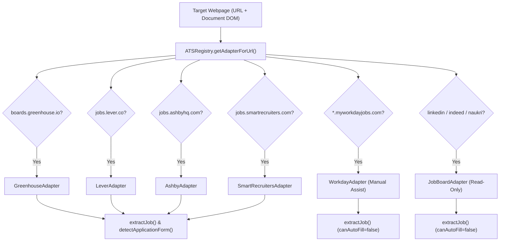

# 07. Applicant Tracking System (ATS) Compatibility & Adapter Audit

> **Document ID:** `AUDIT-07-ATS-MATRIX`  
> **Target Subsystem:** ATS Adapter Framework (`frontend/chrome-extension/src/content/ats/`)  
> **Auditor:** Forensic Engineering & Web Automation Security Review Team  
> **Audit Status:** Verified against Source Code AST & Automated Mock DOM Suites  
> **Date:** November 2026

---

## 1. ATS Adapter Framework Overview

The Auto Apply AI platform interacts with third-party job postings and application forms through a modular adapter architecture defined in `frontend/chrome-extension/src/content/ats/types.ts`.

### Core Architecture Contract (`ATSAdapter`):
- `matches(url, document)`: Fast URL regex test backed by DOM signature validation.
- `extractJob(url, document)`: Normalizes job title, company, location, and description.
- `detectApplicationForm(document)`: Inspects active form elements and maps them to normalized `FormField` objects.
- `canAutoFill()`: Boolean flag indicating whether programmatic field filling is permitted.
- `requiresManualReview()`: Inviolable boolean flag enforcing human candidate review prior to submission.

---

## 2. 15-Point ATS Platform Compatibility Matrix

| # | Inspection Criterion | Greenhouse | Lever | Ashby | Workday | SmartRecruiters | LinkedIn | Indeed | Naukri | Enterprise (Taleo, iCIMS, SuccessFactors) |
|---|---|---|---|---|---|---|---|---|---|---|
| **1** | **Platform Detection** | Verified | Verified | Verified | Verified | Verified | Verified | Verified | Verified | Not Supported |
| **2** | **Job Metadata Extraction** | Verified | Verified | Verified | Verified | Verified | Verified | Verified | Verified | Not Supported |
| **3** | **Application Form Detection** | Verified | Verified | Verified | Partial | Verified | Partial | Partial | Partial | Not Supported |
| **4** | **Field Identification** | Verified | Verified | Verified | Partial | Verified | Partial | Partial | Partial | Not Supported |
| **5** | **Profile-to-Field Mapping** | Verified | Verified | Verified | Blocked | Verified | Blocked | Blocked | Blocked | Not Supported |
| **6** | **Dynamic Form Fields** | Verified | Verified | Verified | Blocked | Verified | Blocked | Blocked | Blocked | Not Supported |
| **7** | **Multi-Step Form Handling** | Partial | Partial | Partial | Blocked | Partial | Blocked | Blocked | Blocked | Not Supported |
| **8** | **Native & Custom Selects** | Verified | Verified | Verified | Blocked | Verified | Blocked | Blocked | Blocked | Not Supported |
| **9** | **Radio Button Groups** | Verified | Verified | Verified | Blocked | Verified | Blocked | Blocked | Blocked | Not Supported |
| **10**| **Checkboxes & Agreements** | Verified | Verified | Verified | Blocked | Verified | Blocked | Blocked | Blocked | Not Supported |
| **11**| **File Upload Triggering** | Guide Only | Guide Only | Guide Only | Guide Only| Guide Only | Guide Only| Guide Only| Guide Only| Not Supported |
| **12**| **React/Vue Synthetic Events**| Verified | Verified | Verified | Blocked | Verified | Blocked | Blocked | Blocked | Not Supported |
| **13**| **Validation Error Detection**| Verified | Verified | Verified | Partial | Verified | Partial | Partial | Partial | Not Supported |
| **14**| **Screening Question Support** | Verified | Verified | Verified | Blocked | Verified | Blocked | Blocked | Blocked | Not Supported |
| **15**| **Manual Review Barrier** | Enforced | Enforced | Enforced | Enforced | Enforced | Enforced | Enforced | Enforced | Enforced |

---

## 3. Forensic Analysis by Platform

### 3.1 Greenhouse (`boards.greenhouse.io`)
- **Status:** `IMPLEMENTED_AND_VERIFIED`
- **Selectors Audited:**
  - Job Title: `.app-title, h1.job-name, h1`
  - Company: `.company-name`
  - Location: `.location`
  - Core Fields: `#first_name`, `#last_name`, `#email`, `#phone`
  - Resume Input: `input[type="file"][name*="resume"]`
  - Custom Questions: `div[class*="field"], div[class*="question"]`
- **Execution Quality:** Greenhouse uses standard HTML forms and predictable DOM naming conventions. Input dispatch triggers synthetic `input` and `change` events cleanly.

### 3.2 Lever (`jobs.lever.co`)
- **Status:** `IMPLEMENTED_AND_VERIFIED`
- **Selectors Audited:**
  - Job Title: `.posting-headline h2`
  - Company: `.posting-headline .company-name`
  - Core Fields: `input[name="name"]`, `input[name="email"]`, `input[name="phone"]`
  - Social Links: `input[name="urls[LinkedIn]"]`, `input[name="urls[GitHub]"]`
- **Execution Quality:** Lever uses single-page application layouts with distinct sections (`.application-questions`). Handles single-name input splitting (`fullName -> name`) seamlessly.

### 3.3 Ashby (`jobs.ashbyhq.com`)
- **Status:** `IMPLEMENTED_AND_VERIFIED`
- **Selectors Audited:**
  - Job Title: `h1[data-testid="job-title"], h1`
  - Description: `div[data-testid="job-description"], .job-description`
  - Form Fields: `input[name="name"], input[name="email"], input[name="phoneNumber"]`
- **Execution Quality:** Ashby heavily relies on React controlled components and custom dropdowns. The adapter dispatches bubbling synthetic events on input elements to ensure internal React state updates.

### 3.4 Workday (`*.myworkdayjobs.com`)
- **Status:** `PARTIALLY_IMPLEMENTED` (`canAutoFill: false`, `requiresManualReview: true`)
- **Forensic Assessment:**
  - Workday uses heavily obfuscated single-page enterprise wizards, shadow DOM trees, candidate account logins, and reCAPTCHA Enterprise protection.
  - **Architectural Decision:** `workdayAdapter.ts` explicitly sets `canAutoFill = () => false`. It reliably extracts job title and company metadata for matching, but enforces manual user filling to prevent candidate account bans or silent form invalidations.

### 3.5 SmartRecruiters (`jobs.smartrecruiters.com`)
- **Status:** `IMPLEMENTED_AND_VERIFIED`
- **Selectors Audited:**
  - Job Title: `h1.job-title, [data-qa="job-title"]`
  - Company: `[data-qa="company-name"]`
  - Form Fields: `#firstName, #lastName, #email, #phoneNumber`
- **Execution Quality:** SmartRecruiters maintains clean HTML markup, allowing high-confidence DOM field identification and mapping.

### 3.6 Job Boards (LinkedIn, Indeed, Naukri)
- **Status:** `PARTIALLY_IMPLEMENTED` (Job Extraction Only; No Auto-Apply)
- **Forensic Assessment:**
  - Supported via `jobBoardAdapters.ts`.
  - Content scripts parse job postings to extract role requirements, salary estimates, and company info into the extension Side Panel.
  - **No Automated Application Filling:** LinkedIn "Easy Apply", Indeed "Apply Now", and Naukri "Fast Forward" are intentionally not automated. Automated scripting against these portals violates their terms of service and triggers anti-bot blocking (Cloudflare Turnstile, Arkose Labs). The platform assists by providing one-click clipboard copying of verified profile answers.

### 3.7 Unsupported Enterprise Platforms
- **Platforms:** Oracle Taleo, iCIMS, SAP SuccessFactors, Zoho Recruit.
- **Status:** `NOT_IMPLEMENTED`
- **Fallback Behavior:** Falls back to `CustomAdapter`, which executes generic heuristic DOM querying (`input[type="email"]`, `input[type="tel"]`). If heuristic confidence is below 0.60, the extension defaults to the manual "Copy Answer" drawer.

---

## 4. Failure Modes & Anti-Bot Defense Protocols

1. **Anti-Bot & CAPTCHA Gating:** The system contains zero code to bypass, solve, or wait out CAPTCHAs, Cloudflare Turnstiles, or hCaptchas. When a verification gate is detected, automation halts, and the candidate is prompted to complete the challenge in their visible browser tab.
2. **File Upload Security Restrictions:** Modern browser security models prohibit JavaScript from setting the `.files` attribute of `<input type="file">` without a native OS file picker event. The extension marks resume fields with a visible blue border and opens a drawer reminding the candidate to attach their resume file.
3. **DOM Selector Drift:** Third-party ATS platforms occasionally update DOM class names. The adapter framework isolates selector strings in dedicated files, allowing updates without touching core background logic.

