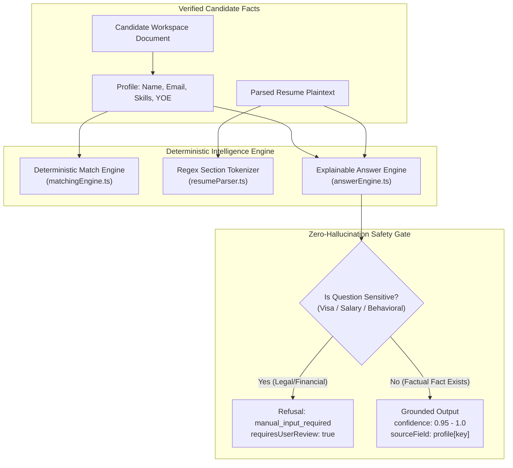
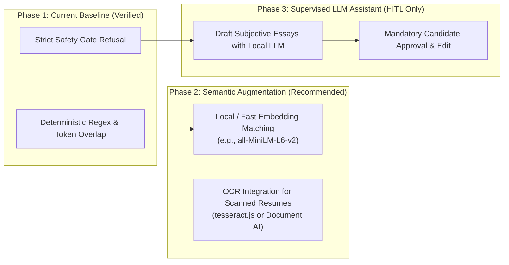

# 08. AI & Intelligence Engine Forensic Audit

> **Document ID:** `AUDIT-08-AI-ENGINE`  
> **Target Subsystems:** Matching Engine (`matchingEngine.ts`), Resume Parser (`resumeParser.ts`), Answer Engine (`answerEngine.ts`)  
> **Auditor:** Forensic AI/ML Engineering & Ethics Review Team  
> **Audit Status:** Verified against Source Code AST & Negative Assertion Test Suites  
> **Date:** November 2026

---

## 1. System Reality: Deterministic Intelligence vs Generative LLM

A foundational finding of this forensic audit is that **the current codebase does not execute any remote Generative Large Language Model (e.g., OpenAI GPT-4, Google Gemini, Anthropic Claude) or local transformer models**.

Instead, all intelligence capabilities are driven by **deterministic, explainable token algorithms, regex pattern recognizers, bounded skill dictionaries, and mathematical scoring functions**.



### Strategic Evaluation of Deterministic Approach:
1. **Zero Hallucination:** Generative LLMs frequently hallucinate skills, invent years of experience, or fabricate work authorizations. A deterministic engine is mathematically incapable of inventing facts not present in the candidate workspace.
2. **Explainability & Auditability:** Every match score produces explicit `evidence` and `missingEvidence` arrays that can be inspected by the candidate.
3. **Zero Inference Cost:** Operates in sub-millisecond execution times without external API costs, rate limits, or network dependencies.
4. **Legal & Compliance Integrity:** Adheres to truth-in-hiring regulations by refusing to falsify candidate credentials.

---

## 2. Job Matching Engine (`matchingEngine.ts`)

### 2.1 Scoring Algorithm
Calculates compatibility using normalized factor weights:
```typescript
Score = Round(Σ(Valid Factors) / Count(Valid Factors))
```
Where individual factor scores are bounded between `0` and `100`:
- **Skill Overlap:** Set intersection of candidate skills against mandatory and preferred job skills.
- **Experience Alignment:** Ratio of candidate's verified years of experience to the job's minimum requirement.
- **Title Fit:** Keyword proximity between candidate target role and posting title.
- **Location Compatibility:** Remote compatibility or geographic proximity match.

### 2.2 Hard Eligibility Gatekeeper (`checkHardEligibility`)
Before computing an aggregate score, the engine enforces non-negotiable filters:
1. **Mandatory Skills:** If a job declares mandatory skills, any missing skill is flagged as a blocking obstacle (`blockers.push('Missing mandatory skills: ...')`).
2. **Minimum Experience:** If candidate experience is strictly lower than `experienceMin`, the candidate is marked ineligible (`eligible: false`).
3. **Unknowns Handling:** If required data is absent (e.g. unformatted skill lists), it is recorded in the `unknowns` array rather than silently passing.

---

## 3. Resume Parsing & Extraction Engine (`resumeParser.ts`)

### 3.1 PDF Ingestion Pipeline
- Employs `pdf-parse` to convert binary PDF buffers into UTF-8 text strings.
- Regex header detectors identify major resume sections:
  ```regex
  /(?:^|\n)\s*(EXPERIENCE|WORK HISTORY|EMPLOYMENT|EDUCATION|SKILLS|TECHNICAL SKILLS|PROJECTS|SUMMARY)\b/i
  ```

### 3.2 Skill Extraction & Evidence Linking
- Matches tokens against a bounded technical catalog of 200+ normalized technologies (`TypeScript`, `React`, `Docker`, `PostgreSQL`, `Python`, etc.).
- Extracts supporting sentence quotes for each identified skill, populating `ResumeSkillEvidence`:
  ```typescript
  {
    skill: "React",
    evidence: "Developed responsive web applications using React and Next.js"
  }
  ```

### 3.3 Limitations of the Current Parser
- **No OCR for Scanned Files:** Image-only PDFs (scanned documents) produce empty text strings and trigger an `ocr_required` warning.
- **DOCX Handling:** Relies on plain text decoding rather than deep XML unpacking for multi-column Word tables.

---

## 4. The Zero-Hallucination Answer Engine (`answerEngine.ts`)

### 4.1 Question Classification Taxonomy
The engine classifies arbitrary ATS screening questions into 9 distinct semantic categories:
1. `contact_info`: Name, email, phone, location, social links.
2. `experience_years`: Total years of professional or technology-specific experience.
3. `skill_verification`: Binary or rating questions regarding specific technical competencies.
4. `work_authorization`: Visa sponsorship, citizenship, right to work in jurisdiction.
5. `salary_expectation`: Desired base compensation, hourly rates, CTC expectations.
6. `availability`: Notice periods, earliest start dates.
7. `education`: Degree, major, university, graduation year.
8. `subjective_behavioral`: Open-ended essays ("Why do you want to work here?").
9. `unknown`: Unclassified or unrecognized queries.

### 4.2 Strict Safety Gates for Sensitive Questions
The engine implements hard-coded guardrails refusing automated answer generation for sensitive categories:
```typescript
case 'work_authorization':
case 'salary_expectation':
case 'subjective_behavioral': {
  return {
    question,
    category,
    suggestedAnswer: null,
    confidence: 0,
    isGrounded: false,
    requiresUserReview: true,
    status: 'manual_input_required',
    reason: category === 'work_authorization'
      ? 'Legal work authorization and visa sponsorship questions require candidate personal attestation.'
      : category === 'salary_expectation'
        ? 'Compensation expectations must be provided directly by the candidate.'
        : 'Subjective questions require personal expression and must not be AI-fabricated.'
  };
}
```

---

## 5. AI Evolution & Roadmap Recommendations

To expand system capabilities while preserving zero-hallucination integrity, the following roadmap is recommended:



1. **Semantic Skill Embeddings:** Augment exact token matching with vector embeddings to resolve synonyms (e.g. mapping "Postgres" to "PostgreSQL" or "AWS Lambda" to "Serverless").
2. **OCR Integration:** Add `tesseract.js` worker threads in `resumeParser.ts` when `pdf-parse` yields fewer than 50 characters of text.
3. **Candidate-Supervised Cover Letter Drafting:** Integrate an optional local LLM (e.g., via Ollama) or hosted API to draft cover letters grounded strictly in verified profile bullet points, requiring candidate review before copying.

