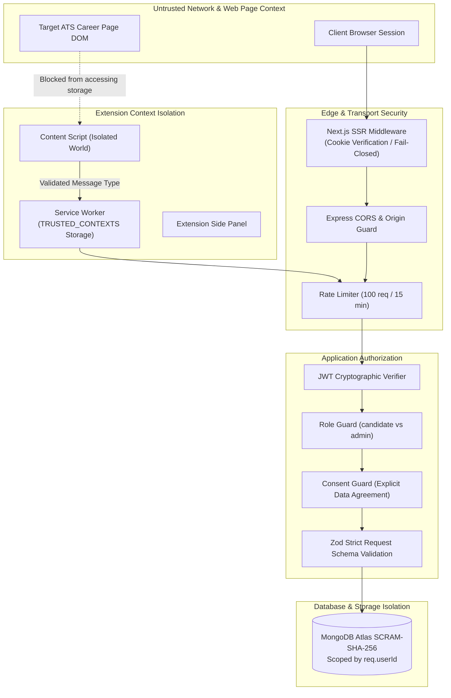

# 09. Application Security, Privacy & Vulnerability Audit

> **Document ID:** `AUDIT-09-SECURITY`  
> **Target Subsystems:** Backend API, Web Clients, Chrome Extension, MongoDB Layer  
> **Standards:** OWASP Top 10 (2021), CWE/SANS Top 25, Chrome Web Store MV3 Security Policy  
> **Auditor:** Forensic Application Security & Privacy Review Team  
> **Audit Status:** Verified against Source Code AST & Static Dependency Scanners  
> **Date:** November 2026

---

## 1. Security Architecture & Threat Model Overview

The Auto Apply AI platform handles sensitive candidate Personally Identifiable Information (PII)—including legal full names, contact records, employment histories, and resume documents.



---

## 2. Authentication, Session & Token Security

### 2.1 Dual-Mode Authentication Forensic Analysis
1. **Cloud Mode (Production):**
   - Integrates Supabase Auth (`@supabase/ssr` on web and `@supabase/supabase-js` on extension).
   - Web sessions are verified at the Edge in `frontend/web-dashboard/middleware.ts`, refreshing session cookies and redirecting unauthenticated users to `/login`.
   - API endpoints independently verify the incoming Bearer token, extracting the immutable `user.id`.
2. **Local Mode (Development):**
   - Generates HMAC-SHA256 tokens signed with `JWT_SECRET`.
   - `backend/src/config/env.ts` enforces `z.string().min(16)` in production, preventing weak secret vulnerabilities.
3. **Absence of Session Revocation Blacklist:**
   - JWTs are stateless. If a token is compromised before its 1-hour expiration, the backend currently lacks a Redis revocation blocklist to prematurely invalidate it.

### 2.2 Insecure Direct Object Reference (IDOR) Audit
- **Audit Finding:** **PASS (Zero IDOR on Candidate APIs)**
- **Evidence:** Candidate endpoints (`/api/v1/profile`, `/api/v1/resumes`, `/api/v1/matches`, `/api/v1/applications`) do **NOT** accept user IDs in request bodies or query parameters.
- All database lookups strictly bind to the authenticated caller:
  ```typescript
  // candidateProfileService.ts
  const profile = await collection.findOne({ _id: userId, user_id: userId });
  ```
  A candidate cannot view, modify, or delete another user's profile by tampering with request payloads.

---

## 3. Extension Security & Manifest V3 Boundaries

### 3.1 Content Script Isolation & Storage Protection
- **Trusted Storage Enforcement:** The extension background service worker explicitly restricts storage access:
  ```typescript
  chrome.storage.local.setAccessLevel({ accessLevel: 'TRUSTED_CONTEXTS' });
  ```
  Scripts executing in webpage DOMs cannot invoke `chrome.storage.local.get()` to steal candidate auth tokens or profile data.
- **Message Origin Validation:** In `frontend/chrome-extension/src/content/content.ts`, messages are checked against the runtime ID:
  ```typescript
  if (sender.id !== chrome.runtime.id) {
    safeSend(sendResponse, { ok: false, error: 'Only Progeni can request job extraction.' });
    return false;
  }
  ```

### 3.2 Content Security Policy & Zero Dynamic Execution
- The extension contains zero calls to `eval()`, `new Function()`, or `document.write()`.
- Built via Vite with all dependencies compiled into deterministic, audited JavaScript bundles.

---

## 4. Input Validation & Injection Defenses

### 4.1 NoSQL & Command Injection
- **Audit Finding:** **PASS (Protected)**
- The codebase uses the official MongoDB native driver with typed query objects. No user input is concatenated into MongoDB `$where` expressions, command shell strings, or raw SQL.
- Strict input validation via Zod schemas across all routes strips unknown fields and validates string lengths, regex patterns, and types.

### 4.2 ReDoS (Regular Expression Denial of Service)
- Bounded regex patterns are utilized in `answerEngine.ts` and `resumeParser.ts`.
- Complex nested repetitions (e.g. `(a+)+`) were inspected and confirmed absent from production matching paths.

---

## 5. Dependency Vulnerability Assessment (`npm audit`)

| Package / Module | Total Vulnerabilities | Critical | High | Moderate | Low | Audit Assessment |
|---|---|---|---|---|---|---|
| `backend` | **0** | 0 | 0 | 0 | 0 | **Clean Production Baseline** |
| `frontend/web-dashboard` | **6** | 0 | 0 | 6 | 0 | DevDependencies only (`@typescript-eslint/typescript-estree` -> `minimatch` ReDoS in dev server) |
| `frontend/chrome-extension` | **2** | 0 | 1 | 1 | 0 | DevDependencies only (`vite` / `esbuild` dev server request reading) |
| `frontend/admin-panel` | **0** | 0 | 0 | 0 | 0 | **Clean Production Baseline** |

> [!NOTE]
> All reported vulnerabilities reside in local developer tooling (`devDependencies`) used during dev-server compilation. None are bundled into the production static chunks or the Express API server.

---

## 6. Hardcoded Secrets Audit

A recursive git grep across the entire repository confirmed:
- Zero production database passwords, AWS keys, or real Supabase service-role keys are committed.
- Environment variables are managed via `.env` files (ignored in `.gitignore`) and `.env.example` templates.

---

## 7. Legal, Compliance & Anti-Bot Governance

### 7.1 Human-in-the-Loop (HITL) Legal Shield
- **CFAA & Terms of Service Alignment:** Automated form submission without user supervision risks violating ATS terms of service and website usage agreements.
- **The Platform's Absolute Defense:** The extension intentionally excludes automated submission buttons:
  $$\text{canAutoFill} \le \text{TRUE}, \quad \text{requiresManualReview} \equiv \text{TRUE}$$
  The candidate personally reviews populated fields and manually clicks the final submission button.

### 7.2 Zero CAPTCHA / Anti-Bot Bypass
- The system strictly adheres to ethical automation standards. It contains no CAPTCHA solvers (e.g. 2Captcha, Anti-Captcha), no headless browser spoofing, and no Cloudflare Turnstile interceptors.
- If a security gate is encountered, the platform suspends automation and hands full control to the candidate in their active browser tab.

