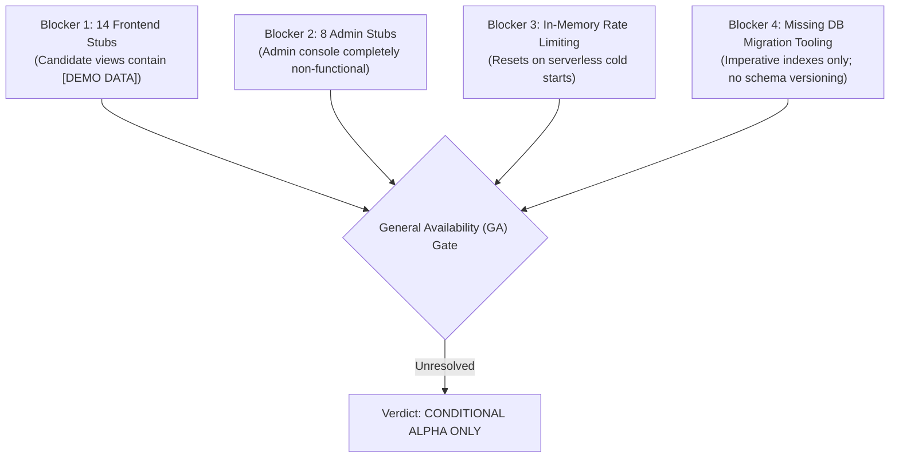

# 11. Production Readiness Scorecard & Release Evaluation

> **Document ID:** `AUDIT-11-PROD-READINESS`  
> **Target System:** Auto Apply AI Platform  
> **Auditor:** Principal Enterprise Architect & Production Readiness Review Board  
> **Audit Status:** Verified against Source Code, Test Logs, and Infrastructure Configs  
> **Date:** November 2026

---

## 1. Production Readiness Scorecard

| Dimension | Readiness Rating | Production Status | Critical Gaps & Assessment |
|---|---|---|---|
| **Backend REST API** | **85%** | `FUNCTIONAL` | Core REST APIs, auth guards, consent middleware, and Zod validations are solid. Needs Redis rate-limiting. |
| **Data Persistence & Database** | **70%** | `NEEDS_ATTENTION` | Dual-model storage is operational with revision locking and cascade deletion, but lacks schema migration tooling. |
| **AI & Intelligence Engine** | **90%** | `READY_FOR_MVP` | Deterministic matching and zero-hallucination answer engine are thoroughly tested and production-ready. |
| **Chrome Extension (MV3)** | **80%** | `FUNCTIONAL` | MV3 compliance verified, side panel functional, trusted storage secured. Needs history navigation watcher. |
| **ATS Adapter Layer** | **75%** | `PARTIAL` | Greenhouse, Lever, Ashby, and SmartRecruiters verified. Workday and job boards safely restricted to manual review. |
| **Candidate Web Dashboard** | **45%** | `BLOCKED` | 7 core screens work well; 14 secondary screens are static 1-line `[DEMO DATA]` placeholders. |
| **Admin Operations Panel** | **15%** | `BLOCKED` | All 8 routes are static `[DEMO DATA]` stubs. No operational management UI exists. |
| **Observability & Monitoring** | **30%** | `NOT_READY` | Console logging only. Lacks structured JSON logging (Pino/Winston) and Sentry error telemetry. |
| **CI/CD & Deployment** | **65%** | `PARTIALLY_READY` | Vercel configuration exists for serverless backend and web dashboard. Lacks automated GitHub Actions CI pipeline. |
| **OVERALL SYSTEM SCORE** | **62%** | `DEVELOPER_PREVIEW` | **NOT READY FOR GENERAL AVAILABILITY (GA). SUITABLE FOR CONTROLLED PRIVATE ALPHA.** |

---

## 2. Production Release Gate Checklist

### 2.1 Security & Environment Configuration
- [x] Passwords hashed using bcrypt with salt factor 10.
- [x] Zero production secrets committed to Git repository.
- [x] Chrome MV3 content scripts isolated from DOM page contexts.
- [x] Trusted storage levels enforced (`chrome.storage.local.setAccessLevel`).
- [ ] Production Supabase Auth project configured with custom SMTP email templates.
- [ ] Database connection string configured with dedicated least-privilege Atlas user.
- [ ] Replace in-memory rate limiter with Redis-backed store (`rate-limit-redis`).

### 2.2 Database & Data Integrity
- [x] Unique compound indexes created for application deduplication.
- [x] Optimistic concurrency revision locks active on `candidate_workspaces`.
- [x] Data cascade deletion wipes all candidate records across 6 collections.
- [ ] Install and configure database migration framework (`migrate-mongo`).
- [ ] Implement multi-document MongoDB ACID transaction on dual-model updates.

### 2.3 Candidate Dashboard & User Experience
- [x] Primary dashboard view connected to live backend APIs.
- [x] PDF resume upload, parsing, and ATS score inspection operational.
- [x] Controlled application tracking table operational.
- [ ] Replace 14 placeholder `[DEMO DATA]` screens with functional React components.
- [ ] Implement live interview preparation interface.
- [ ] Implement interactive skill gap visualization chart.

### 2.4 Chrome Extension & Chrome Web Store Submission
- [x] Manifest V3 compliance verified (no dynamic eval, no background persistent pages).
- [x] Extension side panel configured to launch on action button click.
- [x] Absolute manual review barrier enforced on all supported ATS adapters.
- [ ] Complete Chrome Web Store asset package (128x128 icons, promotional tiles, demo video).
- [ ] Publish public privacy policy URL explaining user-authorized form assistance.

---

## 3. External Dependencies & Operational Blockers

1. **Frontend Completion Gap:** A public candidate expects complete navigation. Accessing `/application-details` or `/learning-roadmap` currently renders raw `[DEMO DATA]` text.
2. **Serverless Concurrency & Connection Pooling:** Running Express on Vercel Functions with dynamic outbound IPs requires MongoDB Atlas `0.0.0.0/0` network rules unless static NAT gateways are provisioned. Connection pool size is correctly capped at 3, but high traffic bursts require connection caching via Prisma Accelerate or MongoDB Atlas Serverless.
3. **Third-Party ATS DOM Volatility:** ATS vendors update their HTML markup without warning. A production deployment requires a remote selector endpoint so the extension can update selectors without waiting for Chrome Web Store extension reviews.

---

## 4. Final Production Readiness Verdict

> ### VERDICT: CONDITIONAL / NOT YET GA READY
>
> The Auto Apply AI platform has an exceptionally strong, tested, and secure backend foundation. The deterministic matching engine, explainable answer engine, and Chrome MV3 extension architecture are well-engineered and free of critical vulnerabilities.
>
> **However, the project cannot be launched to general public users in its current state** due to the 14 stubbed candidate screens, non-functional admin console, lack of database migration tooling, and missing distributed rate limiting.
>
> **Recommended Launch Posture:**
> 1. Launch **Private Developer Alpha** immediately using the 7 working candidate screens and Chrome Extension.
> 2. Complete Phase 1 and Phase 2 roadmap items before opening public candidate registration.

