# 12. Strategic Phased Implementation Roadmap

> **Document ID:** `AUDIT-12-ROADMAP`  
> **Target System:** Auto Apply AI Platform  
> **Auditor:** Principal Enterprise Architect & Program Lead  
> **Date:** November 2026

---

## 1. Roadmap Architecture & Execution Philosophy

This roadmap follows a strict **"Preserve Core, Harden Security, Complete User Experience"** methodology. Rather than rewriting working services, development progresses sequentially across 8 distinct phases:

```mermaid
flowchart LR
    P0["Phase 0: Stabilization<br/>(COMPLETED)"] --> P1["Phase 1: Candidate UI<br/>(2 Weeks)"]
    P1 --> P2["Phase 2: ATS Resiliency<br/>(2 Weeks)"]
    P2 --> P3["Phase 3: Admin Console<br/>(1.5 Weeks)"]
    P3 --> P4["Phase 4: Prod Infra<br/>(1 Week)"]
    P4 --> P5["Phase 5: Supervised AI<br/>(2 Weeks)"]
    P5 --> P6["Phase 6: India Localization<br/>(1.5 Weeks)"]
    P6 --> P7["Phase 7: Global Expansion<br/>(2 Weeks)"]
```

---

## 2. Phase-by-Phase Implementation Specifications

### Phase 0: Forensic Stabilization & Core Hardening
- **Status:** `COMPLETED & VERIFIED`
- **Accomplishments:**
  - Resolved route deadlock on `POST /api/v1/jobs` in `server.ts`.
  - Removed duplicate `authMiddleware` calls across routes.
  - Implemented strict Zod request validation across all 5 controller modules.
  - Built explainable fact-grounding `answerEngine.ts` with zero-hallucination barriers.
  - Expanded test suite to 32 tests with 100% pass rate.
  - Configured ESLint across both Next.js applications for clean, zero-warning builds.

---

### Phase 1: Candidate Experience Completion
- **Goal:** Replace the 14 stubbed candidate screens with fully functional, responsive React App Router views.
- **Estimated Effort:** 2 Weeks (1 Senior Full-Stack Engineer)
- **Key Deliverables:**
  1. `app/(candidate)/application-details/[id]/page.tsx`: Dynamic route rendering full application timeline, submission notes, and ATS link.
  2. `app/(candidate)/interview-center/page.tsx`: Behavioral and technical Q&A preparation view based on matched job requirements.
  3. `app/(candidate)/skill-gap-analyzer/page.tsx`: Interactive skill distribution chart highlighting missing skills across target roles.
  4. `app/(candidate)/notifications/page.tsx`: In-app notification center for new job matches and stage updates.
  5. `app/(candidate)/onboarding/page.tsx`: Interactive 3-step wizard (Upload Resume -> Verify Profile -> Install Extension).
- **Verification Criteria:**
  - Zero `[DEMO DATA]` text remains in `frontend/web-dashboard`.
  - Next.js production build succeeds with 0 ESLint warnings.

---

### Phase 2: ATS Automation Resiliency & Remote Selector Service
- **Goal:** Harden extension autofill across Greenhouse, Lever, Ashby, Workday, and SmartRecruiters against DOM drift.
- **Estimated Effort:** 2 Weeks (1 Senior Extension Engineer)
- **Key Deliverables:**
  1. `backend/src/routes/selectors.ts`: Remote API endpoint serving cached ATS selector definitions.
  2. `chrome-extension/src/content/ats/remoteRegistry.ts`: Extension service fetching remote selectors with offline caching.
  3. `chrome-extension/src/content/ats/spaNavigation.ts`: MutationObserver and `chrome.webNavigation` watcher to handle single-page application route transitions.
  4. Multi-step form stepper: Visual indicator in extension side panel guiding candidates through multi-page applications.
- **Verification Criteria:**
  - 100% successful form detection across 20 live representative ATS test pages.
  - Synthetic event triggers verified across React, Vue, and Angular inputs.

---

### Phase 3: Administrative Operations & Compliance Console
- **Goal:** Implement the 8 placeholder routes in `frontend/admin-panel` to provide platform oversight and compliance tracking.
- **Estimated Effort:** 1.5 Weeks (1 Full-Stack Engineer)
- **Key Deliverables:**
  1. `admin-panel/app/dashboard/page.tsx`: Real-time analytics dashboard (Active Candidates, Matches Generated, Applications Tracked).
  2. `admin-panel/app/user-management/page.tsx`: Paginated candidate table with role management and GDPR cascade deletion triggers.
  3. `admin-panel/app/platform-adapter-management/page.tsx`: ATS adapter health monitor tracking autofill success/failure rates.
  4. `admin-panel/app/compliance-automation-policy/page.tsx`: Audit log viewer inspecting candidate consent records and refusal events.
- **Verification Criteria:**
  - Role-based authorization: Non-admin users strictly redirected with `403 Forbidden`.
  - Admin operations reflect live MongoDB state.

---

### Phase 4: Production Infrastructure, Redis & Migrations
- **Goal:** Upgrade infrastructure from developer preview to high-availability production standard.
- **Estimated Effort:** 1 Week (1 DevOps / Backend Engineer)
- **Key Deliverables:**
  1. Redis Rate Limiter: Replace in-memory `express-rate-limit` with Upstash Redis or AWS ElastiCache.
  2. Database Migrations: Integrate `migrate-mongo` for declarative index creation and schema versioning.
  3. Structured Logging: Implement `pino` logger with correlation IDs (`x-request-id`) across all Express requests.
  4. CI/CD GitHub Actions: Automated pipeline running `npm test`, `npm run lint`, and build checks on pull requests.
- **Verification Criteria:**
  - Horizontal container test: Rate limits persist across multiple Express instances.
  - Clean migration rollback test in staging environment.

---

### Phase 5: Supervised AI Augmentation & Semantic Vector Search
- **Goal:** Enhance deterministic matching with semantic embeddings while maintaining zero-hallucination guardrails.
- **Estimated Effort:** 2 Weeks (1 AI/ML Engineer + 1 Backend Engineer)
- **Key Deliverables:**
  1. Embedding Pipeline: Integrate local or fast embedding model (`all-MiniLM-L6-v2`) for skill synonym resolution.
  2. OCR Resume Parsing: Integrate `tesseract.js` worker thread for scanned PDF resumes.
  3. Candidate-Supervised Cover Letter Drafter: LLM drafting endpoint grounded strictly in verified profile bullets, requiring candidate edit and approval before copy.
- **Verification Criteria:**
  - Zero hallucination test: LLM refuses to insert skills or employers not present in the candidate workspace.
  - OCR extracts text from image-based sample resumes with $> 90\%$ accuracy.

---

### Phase 6: India-First Localization
- **Goal:** Optimize job extraction, currency, and portal handling for the Indian technical job market.
- **Estimated Effort:** 1.5 Weeks (1 Full-Stack Engineer)
- **Key Deliverables:**
  1. Indian Job Portal Adapters: Deep inspection for Naukri.com, Foundit (Monster India), and Cutshort.
  2. Compensation Formatter: Support for INR Lakhs (LPA) and CTC structures in match scoring and display.
  3. Notice Period Logic: Support standard Indian notice periods (15 days, 30 days, 60 days, 90 days) in answer engine.
- **Verification Criteria:**
  - Verified extraction from Naukri job search and JD detail pages.
  - Accurate conversion of "12-18 LPA" into normalized annual salary bounds.

---

### Phase 7: Global Expansion & Multi-Browser Support
- **Goal:** Expand system compatibility to US, UK, Canada, and Australia markets and non-Chrome browsers.
- **Estimated Effort:** 2 Weeks (1 Extension Engineer + 1 Full-Stack Engineer)
- **Key Deliverables:**
  1. Currency & Visa Normalization: Support USD, GBP, CAD, AUD, and country-specific work authorizations (H-1B, OPT, UK Tier 2, etc.).
  2. Cross-Browser Manifest: WebExtensions polyfill for Mozilla Firefox and Microsoft Edge.
  3. Safari Web Extension: Xcode wrapper project for macOS Safari support.
- **Verification Criteria:**
  - Extension loads and passes tests in Firefox, Edge, and Chrome.
  - Multi-currency salary matching verified via test suites.

