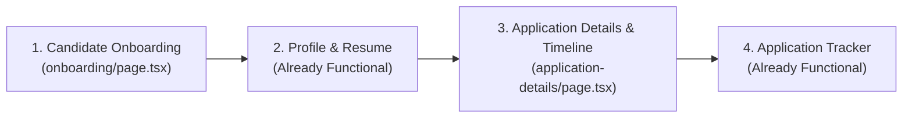
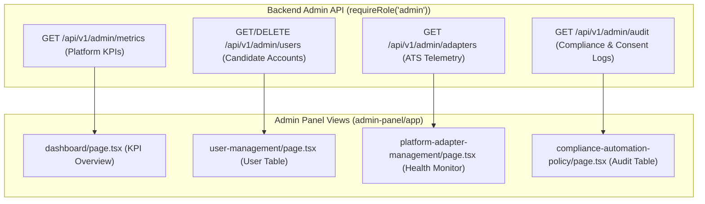

# 16. Next Implementation Plan: Candidate & Admin UI Completion

> **Document ID:** `AUDIT-16-NEXT-PLAN`  
> **Phase:** Phase 0D — Implementation Strategy & Screen-by-Screen Blueprint  
> **Auditor:** Forensic Engineering & Product Architecture Review Team  
> **Date:** November 2026

---

## 1. Implementation Philosophy & Golden Rules

1. **Strictly Build on Existing Working APIs:** All new views must consume existing, verified endpoints in `backend/src/routes/` and client methods in `frontend/web-dashboard/lib/api.ts`.
2. **Zero Fake or Fabricated Data:** New screens must bind to real candidate workspace state. If a record is absent, display a clear, helpful empty state prompting the candidate to take action.
3. **Preserve Human-in-the-Loop Integrity:** Application tracking, review, and preparation screens must empower candidate decision-making rather than simulating automated bot actions.

---

## 2. Priority 0 (P0) Candidate Screens: Core Funnel

### 2.1 Candidate Onboarding (`app/(candidate)/onboarding/page.tsx`)
- **Current State:** 1-line stub (`[DEMO DATA]`).
- **Target Implementation:** A 3-step interactive onboarding wizard:
  - **Step 1: Identity & Target Role:** Form for full name, target title, location preferences, and minimum salary.
  - **Step 2: Resume Ingestion:** Drag-and-drop file upload calling `parseResume()` in `lib/api.ts`, extracting skills and experience immediately into workspace state.
  - **Step 3: Extension Pairing & Consent:** Explanation of the Chrome extension, a 1-click consent acceptance button calling `acceptConsent()`, and extension download instructions.
- **Dependencies:**
  - `lib/api.ts`: `getProfile()`, `saveProfile()`, `parseResume()`, `acceptConsent()`.
- **Verification:** Completing the wizard redirects to `/dashboard` with an initialized, populated workspace.

### 2.2 Application Details & Submission Timeline (`app/(candidate)/application-details/page.tsx`)
- **Current State:** 1-line stub (`[DEMO DATA]`).
- **Target Implementation:** Full application detail inspection view:
  - Dynamic URL parameter or query state: `?id=<applicationId>`.
  - **Lifecycle Stepper:** Visual timeline showing status transitions (`Discovered` -> `Prepared` -> `Submitted` -> `Interviewing` -> `Offered / Closed`).
  - **Matched Job Metadata Card:** Role title, company name, location, job description preview, and direct link to the external ATS portal.
  - **Application Notes Editor:** Rich text area allowing candidate to log referral contacts, interview dates, and custom notes calling `updateApplication()`.
- **Dependencies:**
  - `lib/api.ts`: `getApplications()`, `updateApplication()`.
- **Verification:** Candidate can edit notes, change stages, and view the timestamped audit log.

---

## 3. Priority 1 (P1) Candidate Screens: Intelligence & Preparation

### 3.1 Interview Center (`app/(candidate)/interview-center/page.tsx`)
- **Current State:** 1-line stub (`[DEMO DATA]`).
- **Target Implementation:**
  - **Active Interview Pipeline:** Filtered list of applications in `interview` status.
  - **Grounded Q&A Preparation:** Displays behavioral questions tailored to the matched job description (e.g. leadership principles, technical conflict resolution) with candidate's verified resume bullet points side-by-side.
  - **Preparation Notes:** Local candidate scratchpad for talking points.
- **Dependencies:**
  - `lib/api.ts`: `getApplications()`, `getProfile()`, `getMatches()`.

### 3.2 Skill Gap Analyzer (`app/(candidate)/skill-gap-analyzer/page.tsx`)
- **Current State:** 1-line stub (`[DEMO DATA]`).
- **Target Implementation:**
  - **Skill Compatibility Matrix:** Visual radar or bar chart comparing candidate's verified skills against aggregated requirements across all tracked jobs.
  - **High-Impact Missing Skills:** List of missing skills appearing in $> 30\%$ of targeted jobs (e.g. "Docker required in 4 of 6 tracked roles").
  - **Actionable Bridge Recommendations:** Direct links to documentation or projects to acquire missing competencies.
- **Dependencies:**
  - `lib/api.ts`: `getProfile()`, `getMatches()`.

### 3.3 Notifications & Activity Log (`app/(candidate)/notifications/page.tsx`)
- **Current State:** 1-line stub (`[DEMO DATA]`).
- **Target Implementation:**
  - Activity feed recording:
    - New high-match jobs evaluated by the Chrome extension.
    - Application status transitions and interview milestones.
    - Profile completeness and resume keyword density alerts.
- **Dependencies:**
  - Derived from `getApplications()` and `getMatches()` timestamps.

---

## 4. Priority 2 (P2) Candidate Screens: Secondary Features

| Screen Path | Target Functionality | Data Dependencies |
|---|---|---|
| `learning-roadmap` | Curated roadmap based on `missingEvidence` from job matches. | `getMatches()` |
| `performance-analytics` | Conversion funnel: Applications submitted vs interview rate. | `getApplications()` |
| `application-review` | Pre-submission checklist showing green/amber field status. | `getProfile()`, `getMatches()` |
| `current-job-detection` | Active browser tab detection status synced with extension. | `chrome.storage.session` |
| `follow-up-manager` | Reminder scheduler for jobs submitted $> 7$ days ago. | `getApplications()` |
| `job-match-intelligence` | In-depth breakdown of skill overlap, title fit, and blockers. | `getMatches()` |
| `job-recommendations` | Ranked job cards sorted by descending match score. | `getMatches()`, `getJobs()` |
| `strengths-and-weaknesses`| Summary of candidate's verified core strengths and resume gaps. | `getProfile()`, `getResumes()` |

---

## 5. Admin Panel Implementation Blueprint (`frontend/admin-panel`)

All 8 routes in `frontend/admin-panel` are currently static stubs. The following backend endpoints and frontend views must be constructed:

### 5.1 Admin Screen Execution Steps:
1. **Admin Login (`app/login/page.tsx`):** Standard email/password form verifying `role === 'admin'`. Rejects standard candidate credentials.
2. **Admin Dashboard (`app/dashboard/page.tsx`):** Displays platform KPIs: Total Registered Candidates, Total Jobs Indexed, Total Matches Computed, Applications Submitted.
3. **User Management (`app/user-management/page.tsx`):** Paginated candidate table with search, role toggle, and cascade account deletion trigger.
4. **Platform Adapter Management (`app/platform-adapter-management/page.tsx`):** Real-time health view tracking autofill success vs manual fallback rates for Greenhouse, Lever, Ashby, and Workday.
5. **Compliance Policy & Logs (`app/compliance-automation-policy/page.tsx`):** Searchable table of candidate consent timestamps and manual review events for legal auditability.

