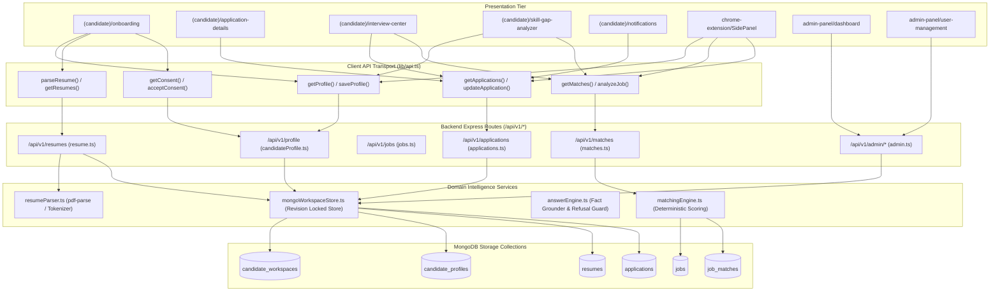

# 17. Infrastructure Evaluation & Implementation Dependency Map

> **Document ID:** `AUDIT-17-DEPENDENCY-MAP`  
> **Phase:** Phase 0E — Infrastructure Evaluation & Technical Dependency Map  
> **Auditor:** Enterprise Infrastructure & Systems Architecture Team  
> **Date:** November 2026

---

## 1. Technical Dependency Architecture Map

This map outlines the exact relationship between presentation views, backend REST endpoints, domain services, database collections, and external systems:



---

## 2. Infrastructure Improvement Proposals: Forensic Evaluation

In accordance with strict audit governance, every proposed infrastructure enhancement is evaluated for necessity, compatibility, risk, and effort before any package installation is permitted.

### 2.1 Distributed Rate Limiting (`rate-limit-redis`)
- **Is it actually necessary?**  
  **CONDITIONAL.** In local development or single-container Node.js instances, in-memory `express-rate-limit` is completely sufficient. However, if deployed to serverless environments (Vercel) where each function invocation is isolated, in-memory rate limits do not persist across requests.
- **Does existing architecture support it?**  
  Yes. `express-rate-limit` natively accepts custom stores (`rate-limit-redis`).
- **Files to modify:** `backend/src/server.ts`, `backend/src/config/env.ts`.
- **Security Risks:** If the Redis instance becomes unreachable, the rate limiter must fail open (`passOnStoreError: true`) so legitimate candidates are not blocked from logging in.
- **Implementation Effort:** 0.5 Developer Days.
- **Prerequisite:** Upstash Redis or AWS ElastiCache cluster provisioned. **Do NOT install locally until serverless deployment is finalized.**

### 2.2 Token Revocation & Session Blacklisting
- **Is it actually necessary?**  
  **MEDIUM NECESSITY.** In production, Supabase Auth handles cloud session invalidation natively through its own refresh token rotation. For local HMAC development tokens, revocation is only relevant during explicit password resets.
- **Does existing architecture support it?**  
  Supported. Can be implemented by checking a `revoked_tokens` collection in MongoDB or Redis keys with a TTL matching JWT expiration (1 hour).
- **Files to modify:** `backend/src/middlewares/auth.ts`, `backend/src/routes/auth.ts`.
- **Security Risks:** Minimal; adds a fast index lookup on incoming requests.
- **Implementation Effort:** 1 Developer Day.

### 2.3 MongoDB Schema Versioning & Migrations (`migrate-mongo`)
- **Is it actually necessary?**  
  **HIGH NECESSITY FOR STAGING/PROD.** Currently, indexes are created imperatively inside `backend/src/config/mongodb.ts` via `Promise.all([db.collection('resumes').createIndex(...)...])` on server startup. While functional, it lacks rollback capabilities, execution history, and schema change tracking.
- **Does existing architecture support it?**  
  Yes. `migrate-mongo` uses the standard native `mongodb` driver (`MongoClient`, `Db`) already present in `backend/package.json`.
- **Files to modify:** `backend/migrations/*`, `backend/migrate-mongo-config.js`, `backend/package.json`.
- **Security Risks:** Migration scripts must be tested against local test databases before execution in production to avoid accidental lock contention or data truncation.
- **Implementation Effort:** 1 Developer Day.

### 2.4 Extension Single Page Application (SPA) Navigation Watcher
- **Is it actually necessary?**  
  **HIGH NECESSITY.** Career portals like LinkedIn, Indeed, and Workday load job postings dynamically via client-side routing (`pushState` / `replaceState`). Without an SPA navigation listener, content scripts only inspect the first job opened in a tab.
- **Does existing architecture support it?**  
  Yes. Chrome Manifest V3 service workers can observe `chrome.webNavigation.onHistoryStateUpdated` or `chrome.tabs.onUpdated`.
- **Files to modify:** `frontend/chrome-extension/src/background/service-worker.ts`, `manifest.json`.
- **Security Risks:** None. Requires adding `"webNavigation"` to `manifest.json` permissions.
- **Implementation Effort:** 1 Developer Day.

### 2.5 Remote ATS Selector Configuration Service
- **Is it actually necessary?**  
  **HIGH STRATEGIC VALUE.** ATS vendors (Greenhouse, Lever, Ashby) periodically modify HTML classes. A remote selector service allows fixing broken selectors instantly on the backend without requiring candidate browser extensions to wait 3–7 business days for Chrome Web Store review.
- **Does existing architecture support it?**  
  Yes. Create `GET /api/v1/selectors` returning a JSON map of platform selectors; the extension caches this in `chrome.storage.local` with hardcoded fallback.
- **Files to modify:** `backend/src/routes/selectors.ts`, `frontend/chrome-extension/src/content/ats/registry.ts`.
- **Security Risks:** Selector payloads must be validated against a strict schema to prevent DOM-based XSS injection via malicious selector attributes.
- **Implementation Effort:** 2 Developer Days.

### 2.6 Compound Application Idempotency Index
- **Is it actually necessary?**  
  **ALREADY IMPLEMENTED & VERIFIED.**  
  In `backend/src/config/mongodb.ts` (lines 44–47), the compound unique index is already active:
  ```typescript
  db.collection('applications').createIndex(
    { user_id: 1, idempotency_key: 1 },
    { unique: true }
  )
  ```
  And in `backend/src/applicationService.ts`, MongoDB `11000` duplicate key errors are handled gracefully. No further package or schema modification is needed.

### 2.7 Browser End-to-End (E2E) Testing with Playwright
- **Is it actually necessary?**  
  **CRITICAL QUALITY ASSURANCE GATE.** Unit tests verify algorithm math and mock DOM parsing, but only an automated browser test can verify that unpacked extension content scripts inject correctly, synthesize typing events, and render side panels.
- **Does existing architecture support it?**  
  Yes. Playwright supports launching Chromium with unpacked extensions via `--load-extension`.
- **Files to modify:** `tests/e2e/extension.spec.ts`, `package.json`.
- **Security Risks:** None (Testing only).
- **Implementation Effort:** 2 Developer Days.

### 2.8 Resume OCR Fallback (`tesseract.js`)
- **Is it actually necessary?**  
  **MEDIUM VALUE.** Scanned or flat-image PDF resumes currently fail plain text extraction and return `ocr_required`. Integrating `tesseract.js` allows parsing scanned documents.
- **Does existing architecture support it?**  
  Supported. Can be executed inside a worker thread in `backend/src/services/resumeParser.ts` when `pdf-parse` extracts $< 50$ characters.
- **Security Risks:** OCR is CPU-intensive. Must be bounded with a processing timeout (e.g. 15 seconds) to prevent server thread starvation.
- **Implementation Effort:** 1.5 Developer Days.

---

## 3. Sequential Implementation Order Matrix

| Order | Task Name | Subsystem | Dependencies | Effort |
|---|---|---|---|---|
| **Step 1** | Replace P0 Candidate Onboarding Screen | `web-dashboard` | Existing `lib/api.ts` | 1 Day |
| **Step 2** | Replace P0 Application Details & Timeline View | `web-dashboard` | Existing `lib/api.ts` | 1 Day |
| **Step 3** | Implement Chrome Extension SPA Navigation Watcher | `chrome-extension`| Manifest V3 `webNavigation` | 1 Day |
| **Step 4** | Build P1 Interview Center View | `web-dashboard` | `getMatches()`, `getApplications()` | 1.5 Days |
| **Step 5** | Build P1 Skill Gap Analyzer View | `web-dashboard` | `getProfile()`, `getMatches()` | 1.5 Days |
| **Step 6** | Implement Remote ATS Selector API & Extension Cache | `backend` + `extension` | MongoDB `ats_selectors` | 2 Days |
| **Step 7** | Install `migrate-mongo` & Formalize Declarative Migrations | `backend` | Native `mongodb` driver | 1 Day |
| **Step 8** | Implement Playwright E2E Browser Extension Suite | `tests/e2e` | Headless Chromium | 2 Days |

